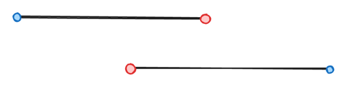
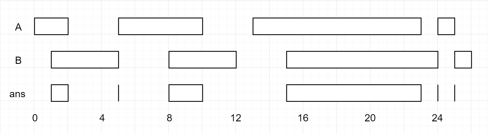
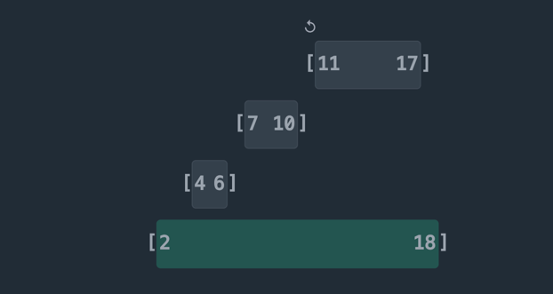
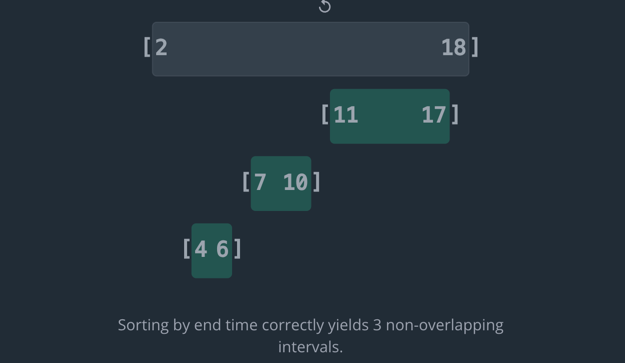

# Intervals

An interval is a range, usually a time slice [start, stop]. In intervals problem you are usually
given a list of intervals, and have to do operation on them.

Example Operations:

- Merge Overlapping Interval
- Insert Interval
- Find max number of intervals (busiest moment)
- Insert Interval (on a non-overlap list of intervals) and merge if needed
- Erase minimum overlapping intervals to make the intervals non-overlap


### How to detect if two intervals overlapped ?
There are a couple of edge cases here, if you think if X2 starts before X1 ends, there maybe a overlap,
but there maybe X2 also ended Before X1, and all other cases
- X1 consumes X2
- X2 Consumes X1
- X1 extends X2, Vice Versa

The only reliable way is to compare the diagonals, that's it



See the *BLUE* and *RED* diagonals, The start must be always before. All possible 4 overlaps 
scenarios are validated by this

**_overlap  ⟺  A.start ≤ B.end  AND  B.start ≤ A.end_** (can be strictly less)
```python
x = [10, 15]
y = [12, 20]

if x[0] < y[1] and x[1] > y[0]: #can be equal if just touch also means overlap
    print("We have overlap")

```

## How To Solve: Sort and Sweep

If we check who overlaps who, it will be all possible pairs and O(n^2) which is not ideal. That's
why we sort, and we only check for neighbors one by one

- **Segment sweep** → sort intervals by start, hold a "current block", extend it or start a new one.
  Best for **merging** and anything where you output intervals.
- **Event sweep** → split each interval into a `+1` start event and a `-1` end event, sort all
  events, walk left to right watching a running counter. Best when you care about **how many
  intervals are active at once** (Meeting Rooms II, max overlap).

### **_1. Segment Sweep_**
Problem: https://leetcode.com/problems/merge-intervals
```python
# Example of Segment Sweep: LeetCode 56 Merge overlapped intervals
# Point to be noted we dont doing exact diagonal check, 
# because as the list is sorted, next intervals starts before current ends, we have overlap
# We just need to check if they overlaps
class Solution:
    def merge(self, intervals: List[List[int]]) -> List[List[int]]:
        
        intervals.sort(key=lambda x: x[0])
        merged = []
        merged.append(intervals[0])

        for i in range(1, len(intervals)):
            if merged[-1][1] >= intervals[i][0]:
                merged[-1][1] = max(intervals[i][1], merged[-1][1])
            else:
                merged.append(intervals[i])
        return merged
```
### **_2. Event Sweep_**
Problem: https://leetcode.com/problems/meeting-rooms-ii

This one is a bit interesting and also complicated, but it's beautiful. We want to know how
many intervals are we in currently, example no of meeting rooms we need

We create a event stream, (time, type) and we process that stream. When we have a interval event, 
if its opening we increase current concurrent, if closing event we decrease

```python
**class Solution:
    def minMeetingRooms(self, intervals: List[List[int]]) -> int:

        events = []
        for start, end in intervals:
            events.append((start, 1))
            events.append((end, -1))

        max_concurrent = 0
        # [1,3], [3,5] is not overlap here
        events.sort(key=lambda x: (x[0], x[1]))
        # If the problem stats [1,3], [3,5] is overlap here, then we want to 
        # increment first and decrement, we want 1 appear before -1 on same timestamp
        # So inverse second key make it behave like max heap
        events.sort(key=lambda x: (x[0], -x[1]))  # -x[1] instead x[1]
        
        
        current = 0
        for _, val in events:
            current += val
            max_concurrent = max(max_concurrent, current)
        return max_concurrent
# Time Complexity: O(nlogn)
# Space Complexity: O(n)**
```
### **_3. Max Overlap Using Heap [Event Sweep Alternative]_**
Problem: https://leetcode.com/problems/meeting-rooms-ii

We can also use a heap to find max overlaps on interval. 
Idea is simple, a heap holds all the current meetings end time, We insert one by one, sorted based on
Start time
 
Heap Root always holds earliest ending meeting, as its a min heap. Before inserting current meeting
We just check which meetings already ended before, we just remove them

```python
class Solution:
    def minMeetingRooms(self, intervals: List[List[int]]) -> int:
        intervals = sorted(intervals, key=lambda x: x[0])
        heap = []
        max_rooms = 0
        for start, end in intervals:
            # Remove all meetings that ends before the new one, corner case handle empty heap
            # Due to the nature of heap, the meeting ends earliest is heap root, so its guaranteed that
            # all the meetings that ends early are kicked out
            while heap and heap[0] <= start:
                heapq.heappop(heap)
            # entering the new meeting
            # Heap holds all concurrently going meeting. We can save IDs in the tuple also
            heapq.heappush(heap, end)
            max_rooms = max(max_rooms, len(heap))
        return max_rooms
```

### **_4. Interval Intersection_**
Given two interval lists A and B, determine where they overlap. Example image explains everything
A is a list of intervals, where intervals are non overlapping. Same for B 

**_Each list of intervals is pairwise disjoint and in sorted order_**

But A and B has common overlays, we need to find them



We use two pointer methind, also need to make sure we sort A and B if not already sorted
Problem: https://leetcode.com/problems/interval-list-intersections

```python
class Solution:
    def intervalIntersection(self, firstList: List[List[int]], secondList: List[List[int]]) -> List[List[int]]:
        i = 0
        j = 0
        overlaps = []
        while i < len(firstList) and j < len(secondList):
            if firstList[i][0] <= secondList[j][1] and firstList[i][1] >= secondList[j][0]:
                start = max(firstList[i][0], secondList[j][0])
                end = min(firstList[i][1], secondList[j][1])
                overlaps.append([start, end])
            # While moving, we move from the one that ends earliest
            # We dont care if they overlap or all, the prevous code already checked
            # And accounted that for
            if firstList[i][1] < secondList[j][1]:
                    i += 1
            else:
                j += 1
        return overlaps

```

### **_5. Remove Minimum Overlaps_**

Remove the fewest intervals so none overlap. Sorting by start does not work: a meeting that starts first might run to the very end and force you to drop everything else.

Sort by end time instead, the meeting that ends earliest frees up soonest, so greedily keeping it leaves the most room for later meetings.

Why this is optimal : among all overlapping candidates, the one ending earliest is never a worse choice to keep, 
any interval a later-ending pick could accommodate, the earlier-ending pick can accommodate too. So the greedy choice is always at least as good as any alternative.




See, we sorted based on start time (bottom to up)  and the first meeting eating all of them, cause its the largest

Solution: Sort by end time, meeting that ends earliest frees up for newer meeting



Example Problem: https://leetcode.com/problems/non-overlapping-intervals/


```python
class Solution:
    def eraseOverlapIntervals(self, intervals: List[List[int]]) -> int:
        # Sort Based on end time
        intervals.sort(key=lambda x: x[1])
        to_remove = 0
        last_interval = intervals[0]
        for i in range(1, len(intervals)):
            # Current meeting created overlap ? Then skip it
            if intervals[i][0] < last_interval[1]:
                to_remove += 1
            else:
                # We select current meeting, not skipping it
                last_interval = intervals[i]
        return to_remove
```

## Additional Problems to Solve
- https://leetcode.com/problems/minimum-number-of-arrows-to-burst-balloons/description/
- https://leetcode.com/problems/employee-free-time/description/